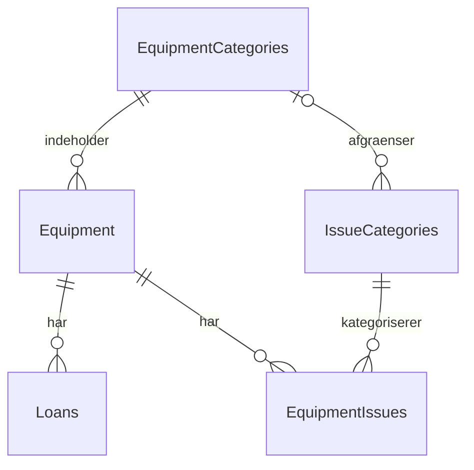

# Datamodel

Alle primærnøgler er UUID'er, som applikationen opretter med UUIDv7. Brugerreferencer er Mercantec Auth-`sub` som UUID. Tidspunkter gemmes i UTC som PostgreSQL `timestamp with time zone`. EF Core sætter `CreatedAt` og `UpdatedAt` ved almindelig `SaveChanges` og bevarer det oprindelige oprettelsestidspunkt ved ændringer.

| Tabel | Centrale felter |
| --- | --- |
| `EquipmentCategories` | `Id`, `Name`, databaseberegnet `NormalizedName` |
| `Equipment` | `Id`, `Name`, `SerialNumber`, `EquipmentCategoryId` |
| `Loans` | `EquipmentId`, `BorrowerSubject`, `ApprovedBySubject`, `LoanedAt`, `Note`, `ReturnedAt`, `ReturnedBySubject`, `ReturnNote` |
| `IssueCategories` | `Name`, databaseberegnet `NormalizedName`, valgfri `EquipmentCategoryId` |
| `EquipmentIssues` | `EquipmentId`, `IssueCategoryId`, `Description`, `ReportedBySubject`, `ReportedAt`, `Status`, `ResolutionNote`, `ResolvedAt`, `ResolvedBySubject` |
| `HardwareDevices` | `SamdId` (primærnøgle), `Mac`, `EccSerial`, `Label`, valgfri/unik `EquipmentId`, `RegisteredAt`, `LastSeenAt` |
| `HardwareTestReports` | `SamdId`, `TestedAt`, `Passed`, `PassedCount`, `FailedCount`, `ReportJson` (JSONB), `Details`, `ImportSource`, `LegacyReportId` |

Inventartabellerne og `HardwareTestReports` indeholder desuden `CreatedAt` og `UpdatedAt`. `HardwareDevices` bruger de særskilte registrerings- og senest-set-tidspunkter. Se [hardwarevejledningen](hardware.md) for testhistorik, tilknytning og import.

## Udstyr og kategorier

Navn og serienummer er påkrævet. Navne og serienumre har indeks; serienumre er ikke gjort unikke, da backloggen kun kræver entydige udstyrs-ID'er. Tilstand er fjernet. API-feltet `faultCount` beregnes ved læsning som antal fejlede, ikke oversprungne komponenter i seneste test pr. tilknyttet board plus antal manuelle fejl med status `Open` eller `InProgress`. En gammel fejlet rapport uden komponentdetaljer tæller som én ukendt hardwarefejl. Antallet gemmes ikke på udstyret og kan ikke vælges i formularen. `0` betyder ingen registrerede aktuelle fejl; det er ikke en garanti for testdækning.

Kategorinavne skal indeholde andet end mellemrum. `lower(btrim("Name"))` beregnes af PostgreSQL og gør kategorinavne unikke uden hensyn til store/små bogstaver og omgivende mellemrum.

## Udlån og historik

`ReturnedAt IS NULL` definerer et aktivt udlån. Et unikt, filtreret indeks på `EquipmentId` sikrer højst ét aktivt udlån pr. udstyr, også når flere requests forsøger at oprette et udlån samtidig.

En returnering kræver både tidspunkt og returgodkender; tidspunktet skal være mindst udlånstidspunktet. UUID'er for låner og godkendere må ikke være tomme. `Note` og `ReturnNote` er separate felter, så returneringsnoten ikke overskriver udlånsnoten.

Afsluttede udlån bliver i `Loans`. Der findes ingen `LoanHistory`-tabel og ingen separat, gemt udlånsstatus på `Equipment`; status udledes af det aktive udlån.

## Fejl og mangler

En fejlkategori gælder globalt, hvis `EquipmentCategoryId` er `NULL`, og ellers for den valgte udstyrskategori. To filtrerede unikke indeks forhindrer dubletter inden for samme afgrænsning, også for globale kategorier.

Fejlrapporter har status `Open`, `InProgress` eller `Resolved`. En løst rapport kræver løsningstidspunkt og ansvarlig bruger. Løsningstidspunktet må ikke ligge før rapporteringen. Åbne og igangværende rapporter har ingen afslutningsoplysninger. En løsningsnote er valgfri.

Udlånsstatus og fejlstatus er uafhængige. Et udstyr kan have både et aktivt udlån og flere åbne fejl. Løste rapporter bevares.

## Ansvar i de kommende funktioner

Databasen håndhæver fremmednøgler, obligatoriske felter, statusværdier, tidsregler og de nævnte unikhedsregler. Relationer bruger `RESTRICT`, så sletning af udstyr og kategorier ikke fjerner tilknyttede udlån eller fejlrapporter.

De kommende API-funktioner skal desuden håndhæve roller, at fejlkategorien passer til udstyrets kategori, lovlige statusovergange og at et allerede afsluttet udlån ikke returneres igen. API'et skal oversætte databasekonflikter til forståelige validerings- eller konfliktbeskeder. Disse forretningsflows er endnu ikke implementeret.

`ExecuteUpdate`, rå SQL og direkte ændringer i databasen går uden om EF Core-tidsstemplingen. Sådanne ændringer skal selv sætte relevante auditfelter. Databasepasswords og loginoplysninger gemmes ikke i tabellerne.
